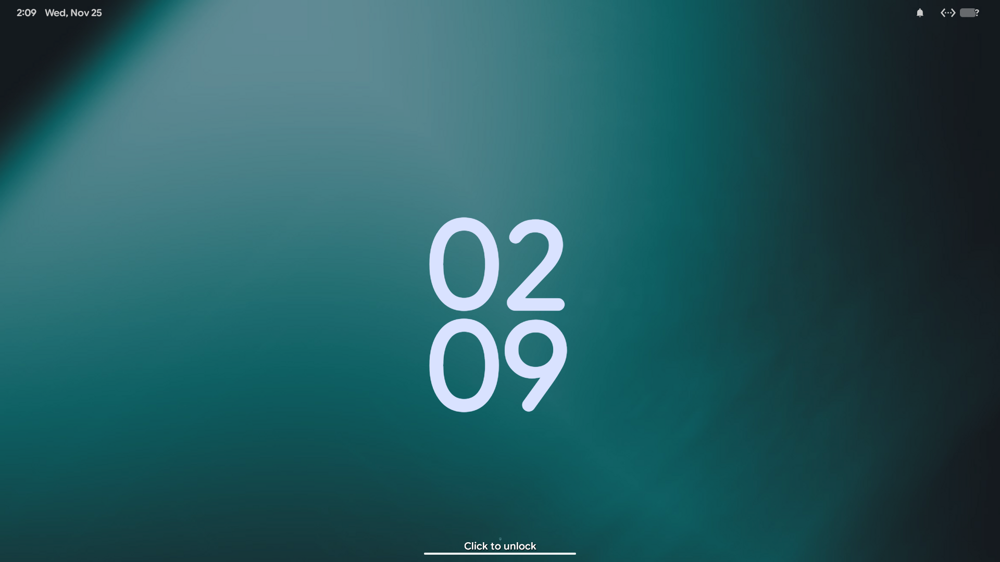

# PcClocks

Lock screen clock styles of LineageOS for PCs: the seven styles Googlebook offers in its
wallpaper and style picker, written anew on top of SystemUI's clock plugin API.

| Module | Package | Clock id | Face |
|---|---|---|---|
| `PcClocks-BigNum` | `com.android.systemui.clocks.bignum` | `ANALOG_CLOCK_BIGNUM` | Analog dial, large heavy 12, 3, 6, 9 |
| `PcClocks-Calligraphy` | `com.android.systemui.clocks.calligraphy` | `DIGITAL_CLOCK_CALLIGRAPHY` | Hours over minutes, bold italic serif |
| `PcClocks-Growth` | `com.android.systemui.clocks.growth` | `DIGITAL_CLOCK_GROWTH` | Hours over minutes, narrow heavy digits with stencil cuts |
| `PcClocks-Inflate` | `com.android.systemui.clocks.inflate` | `DIGITAL_CLOCK_INFLATE` | Wide round digits overlapping, four tones, outlined |
| `PcClocks-Metro` | `com.android.systemui.clocks.metro` | `DIGITAL_CLOCK_METRO` | Digits drawn as transit lines, three nested tones |
| `PcClocks-NumOverlap` | `com.android.systemui.clocks.numoverlap` | `DIGITAL_CLOCK_NUMBEROVERLAP` | Large heavy digits overlapping, two diagonal tones |
| `PcClocks-Weather` | `com.android.systemui.clocks.weather` | `DIGITAL_CLOCK_WEATHER` | Time, date running up the side, weather icon and temperature |

The packages and ids are the ones AOSP's `ClockRegistry` (`KNOWN_PLUGINS`) and ThemePicker's
plugin allowlist (`ClockRegistryProvider`) already name, so SystemUI loads a style only when it is
the current clock and the picker lists all of them without changes to either app.

## Use

```make
$(call inherit-product-if-exists, packages/apps/PcClocks/pc_clocks.mk)
```

The APKs are privileged, platform signed `system_ext` apps holding
`com.android.systemui.permission.PLUGIN`. On `user` builds SystemUI loads only allowlisted
plugins: add the seven packages to SystemUI's `config_pluginAllowlist` (vendor/pc/ui does).

## Layout

| Path | What |
|---|---|
| `lib/src/.../model` | Plain Kotlin, no Android: styles, time split, analog hands, tone schemes and palettes, transit glyphs, weather texts and icons |
| `lib/src/.../face` | Painters (one per kind of face), the face view, the picker thumbnail |
| `lib/src/...` | Clock and face controllers, the provider base class and one provider per style |
| `apps/<Style>/AndroidManifest.xml` | The plugin service of each APK |
| `tests/host` | JUnit tests of the model |

Fonts are the ones the system already ships (Roboto Flex and Noto Serif from AOSP, Google Sans
Flex from LineageOS); no font or image is bundled. The picker thumbnail is the style's own face
drawn at 10:38 in white tones.

## Tests

```sh
atest PcClocksHostTests          # through Soong
tests/run_host_tests.sh          # without a build (tree's kotlinc, JUnit jars from out/)
```

See `DESIGN.md` for how each face is built.

## Screenshots

Taken in QEMU/KVM at 1920x1080 from the live ISO.



Lock screen with the large clock.

## Credits

- [LineageOS](https://lineageos.org) ([GitHub](https://github.com/LineageOS)): the base system and build this is part of.
- [Android Open Source Project](https://source.android.com): the platform, its APIs and build system. The clocks implement SystemUI's clock plugin interfaces.

Thanks to everyone behind these projects. Files taken from them keep their original licenses and copyright notices.
